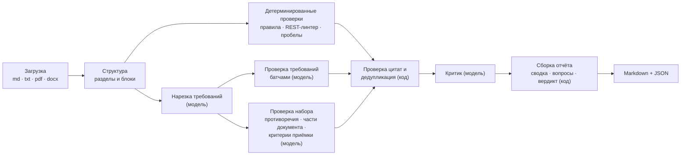

# Агент статической проверки требований

Агент читает документ требований (`.md`, `.txt`, `.pdf`, `.docx`), проверяет его по **ISO/IEC/IEEE 29148:2018** (п. 5.2.5, 5.2.6) и **IEEE 830-1998** (п. 4.3) и выпускает отчёт на русском языке.

## Для жюри

- **Что делает:** одной командой превращает ТЗ в отчёт: нарезка требований, нарушения с дословной цитатой и разделом, проверка набора целиком, вопросы автору ТЗ и вердикт «можно ли начинать разработку и тестирование».
- **Результат на документе кейса:** основной отчёт [`reports/report.md`](reports/report.md) — найдено 24 из 27 эталонных дефектов, критичные 7 из 7.
- **Запуск:** `python -m validator docs/requirements.md reports/report.md` — нужен бесплатный ключ Google AI Studio ([подробнее](#запуск-одной-командой)).
- **Без ключа и сети:** `python -m validator docs/requirements.md out.md --replay reports/trace` пересобирает основной отчёт из сохранённых ответов модели ([подробнее](#проверка-без-ключа-и-сети)).

### Отчёты по документу кейса

Отчёты сделаны агентом, без ручных правок. Модель, глубина рассуждения и версия агента записаны в паспорте каждого отчёта.

| Отчёт | Модель | Найдено эталонных дефектов* | Критичные | Вызовов / время, стоимость |
| --- | --- | --- | --- | --- |
| [`reports/report.md`](reports/report.md) — основной | Anthropic `claude-sonnet-5-5`, глубина рассуждения `high` (`LLM_EFFORT=high`) | 24 из 27 | 7 из 7 | 6 / ~6 мин, ~$1.0 |
| [`reports/gemini/report.md`](reports/gemini/report.md) — то, что воспроизведёт жюри | Google `gemini-3.5-flash` на бесплатном ключе (часть вызовов ушла на запасную `gemini-3.5-flash-lite`) | 19.5 из 27 | 7 из 7 | 6 / ~7 мин, бесплатно |
| [`reports/gemini-3.8-flash/report.md`](reports/gemini-3.8-flash/report.md) | Google `gemini-3.8-flash` через OpenRouter (`LLM_PROVIDER=openrouter`), глубина рассуждения `high`, `LLM_MAX_OUTPUT_TOKENS=64000` | 21 из 27 | 7 из 7 | 6 / ~20 мин, ~$0.87 |

\* Оценка LLM-судьёй по нашему эталону из 27 дефектов: `gemini-3.8-flash` сравнивает находки с эталоном по смыслу. Через API Google `gemini-3.8-flash` в день сдачи отвечал «перегружено», поэтому для неё использован OpenRouter.

### Запуск одной командой

Нужны Python 3.11+ и ключ Google AI Studio: https://aistudio.google.com/apikey

```bash
pip install -r requirements.txt
cp .env.example .env        # Windows: copy .env.example .env — и впишите GEMINI_API_KEY
python -m validator docs/requirements.md reports/report.md
```

- **Модель по умолчанию:** Google `gemini-3.5-flash` (бесплатный ключ), запасная — `gemini-3.5-flash-lite`. Если ключу доступна `gemini-3.8-flash`, укажите её в `GEMINI_MODEL` — это лучший вариант. Поддерживаются также Anthropic API (`LLM_PROVIDER=anthropic`) и OpenRouter (`LLM_PROVIDER=openrouter`).
- **Сколько стоит прогон:** 6–7 вызовов модели, ~150 тыс. входных и ~35 тыс. выходных токенов, 3–8 минут на бесплатном тарифе. Токены и оценка стоимости пишутся в паспорт каждого отчёта.
- **Если квота исчерпана:** агент сам переходит на запасную модель.

### Проверка без ключа и сети

Все три отчёта пересобираются из сохранённых ответов модели — **без ключа и сети**:

```bash
python -m validator docs/requirements.md out.md --replay reports/trace                    # основной отчёт
python -m validator docs/requirements.md out.md --replay reports/gemini/trace             # gemini-3.5-flash
python -m validator docs/requirements.md out.md --replay reports/gemini-3.8-flash/trace   # gemini-3.8-flash
```

Без ключа работает и `--rules-only`: только детерминированные проверки, вердикт «итог не определён».

### Уточнение «было → стало»

Ответьте на вопросы агента и перепроверьте ТЗ:

```bash
python -m validator --questions-template reports/report.json answers.yaml   # шаблон с вопросами
# впишите ответы в answers.yaml, затем:
python -m validator docs/requirements.md reports/after.md --previous reports/report.json --answers answers.yaml
```

В новом отчёте появится раздел «Уточнение: было → стало»: какие дефекты закрыты ответами, что осталось, как изменился вердикт.

Готовый пример: [`examples/clarification/after.md`](examples/clarification/after.md) — ответы автора на 20 вопросов ([`answers.yaml`](examples/clarification/answers.yaml)) закрыли 15 нарушений; открытых стало 27 вместо 38, критичных 0 вместо 7.

### Веб-демо

`python -m validator.web` → http://127.0.0.1:8000. Загрузка ТЗ с прогрессом этапов, просмотр готового отчёта без ключа, выгрузка `.md` и `.json`.

## Что проверяется и что в отчёте

| Уровень | Стандарт | Критерии |
| --- | --- | --- |
| Отдельное требование | ISO/IEC/IEEE 29148:2018, п. 5.2.5; IEEE 830, п. 4.3 | необходимость, уместность уровня, однозначность, полнота, единичность, выполнимость, проверяемость, корректность, соответствие |
| Набор требований | ISO/IEC/IEEE 29148:2018, п. 5.2.6; IEEE 830, п. 4.3 | полнота, согласованность, выполнимость, понятность, валидируемость |
| Спецификация | IEEE 830-1998, п. 4.3.5, 4.3.7, 4.3.8 | ранжирование, модифицируемость, трассируемость |

Пять категорий проверки, которые назвали организаторы, и где они в агенте:

| Категория | Критерии стандарта | Что ловит код без модели |
| --- | --- | --- |
| Дефекты формулировок | однозначность, единичность, соответствие | заглушки и пустые разделы, незаполненные шаблоны |
| Двусмысленность | однозначность, понятность набора | разные единицы одной величины, неопределённые границы периодов |
| Проверяемость | проверяемость, валидируемость | нефункциональные требования без измеримой величины или без точки отсчёта («в течение минуты» — до отправки или до доставки) |
| Логические противоречия | согласованность набора | противоречия между правилами, частями документа и критериями приёмки ищет модель, цитаты проверяет код |
| Лишние проектные решения | уместность уровня | бизнес-логика другой системы внутри спецификации API, REST-линтер; содержание уведомлений без правил маскирования карт и персональных данных (полнота) |

Отчёт пишется в Markdown, как документ кейса (для любого входного формата), и дублируется в JSON для машинной обработки. Исходный документ агент не изменяет.

Разделы отчёта: **паспорт прогона** (документ, SHA-256, дата, модели, версия агента, вызовы, токены, стоимость) → **коротко** → **нарезка требований** (ID в отчёте — ID в документе — цитата) → **проверка каждого требования** → **проверка набора** (противоречия, согласованность частей документа, покрытие критериями приёмки, полнота) → **сводка** → **вопросы к автору ТЗ** (адресат, место, варианты ответа и их последствия) → **итог** («что исправить первым») → **приложение**. Каждое нарушение ссылается на дословную цитату и раздел.

## Архитектура



| Решает код | Решает модель |
| --- | --- |
| Чтение форматов (таблицы DOCX и PDF), разделы и блоки, ID требований в отчёте | Что считать требованием, его тип и формулировка |
| Правила: заглушки и пустые разделы, незаполненные шаблоны, ID и ранжирование, REST-линтер (метод и побочный эффект, коды статусов, типы запроса и ответа), разные единицы одной величины, идемпотентность без ключа, флаг при обязательных параметрах, однострочные схемы процессов | Смысловые дефекты каждого требования, противоречия между правилами, частями документа и критериями приёмки, пробелы в сценариях |
| Проверка каждой цитаты по тексту документа; находка без подтверждённой цитаты не попадает в отчёт | Объяснения, рекомендации, уточняющие вопросы |
| Нумерация, сводка, вердикт, Markdown и JSON | Решения критика проверяются кодом: удалить находку можно только с найденной в документе контрцитатой |

Надёжность и стоимость:
- **Бюджет вызовов:** профиль `standard` (по умолчанию) делает 6–7 вызовов, потолок 10; общий предел времени прогона; на Gemini вызовы идут последовательно, чтобы не упираться в лимит в минуту.
- **Ошибки API:** дневная квота, лимит в минуту, 503, таймаут и сеть различаются; дневная квота сразу переключает на запасную модель, сбой сети завершает прогон честным отчётом «только правила».
- **Кэш этапов** (`.cache/validator`): повторный запуск после обрыва не тратит квоту на готовые этапы.
- **Защита от инструкций внутри документа:** текст ТЗ экранируется и передаётся как данные; нормативные блоки нельзя отбросить; критик не может удалить находки правил.
- **Воспроизводимость без ключа:** `--save-trace DIR` сохраняет ответы модели, `--replay DIR` пересобирает тот же отчёт без ключа и сети.

## Как проверяли качество

`eval/` — офлайн-оценка без участия модели: эталонные списки дефектов, строгий подсчёт (дефект засчитан, только если совпало и место, и суть находки), нижняя граница точности и «шум» на заведомо корректных требованиях.

- **Корпус:** документ кейса и 21 синтетическое банковское ТЗ из разных доменов — 362 эталонных дефекта и 220 заведомо корректных требований (`eval/docs`, `eval/gold`). Чтобы не зависеть от одной модели: 17 документов с эталонами написала модель Google Gemini 4, 4 документа в стилях реальных банковских ТЗ и API-документации — Anthropic `claude-sonnet-5-5`; судьёй для чужих документов выступала модель другого семейства. Эталон по документу кейса составлен вручную. 19 документов слепые: при разработке агент и промпты их не видели.
- **Два способа подсчёта:** строгий по ключевым словам (`eval/score.py`, без модели) и LLM-судья, сравнивающий находки с эталоном по смыслу. Строгий подсчёт занижает результат моделей, пишущих другими словами, поэтому решения принимались по обоим.
- **Доменный профиль «банк/финтех»** (`validator/domains/banking.yaml`, 58 типовых мест неопределённости: авторизация и клиринг, валюта и комиссии, часовые пояса и границы периодов, округление, возвраты, состояния карт, идемпотентность, маскирование данных в уведомлениях…) подключается автоматически по лексике документа (`--domain none` — отключить). Это подсказки для проверки, а не готовые дефекты.
- **Только общие правила:** в промптах и правилах нет терминов из проверяемых документов, это проверяет тест `tests/test_prompt_leak.py`.
- **Каждое изменение принималось по замерам** (несколько прогонов на 9 документах; одна модель между прогонами даёт разброс 2–3 дефекта). Часть идей (отдельный генератор сценариев, разделение проверки набора, двойной проход, подсказки правил модели) не дала устойчивого прироста и в агент не вошла.

| Модель (профиль `standard`) | Документы | Найдено эталонных дефектов | Критичные | Вызовов на прогон |
| --- | --- | --- | --- | --- |
| Google `gemini-3.8-flash`, итоговая конфигурация | 9 документов | 92% (LLM-судья), 89% без доменного профиля и новых проверок | 97% | 6.9 |
| Google `gemini-3.5-flash` (бесплатный ключ) | документ кейса | 19.5 из 27 | 7 из 7 | 6 |
| Anthropic `claude-sonnet-5-5`, глубина рассуждения `high` | документ кейса, 4 прогона до новых правил | 21.5–23.5 из 27 (медиана 22.5) | 6–7 из 7 | 6 |
| Anthropic `claude-sonnet-5-5`, глубина рассуждения `high`, итоговая версия | документ кейса | 24 из 27 | 7 из 7 | 6 (~$1.0) |
| Только правила (`--rules-only`, без модели) | документ кейса | все 3 дефекта новых правил найдены | — | 0 |
| Anthropic `claude-sonnet-5-5`, глубина рассуждения по этапам | 6 документов | 91–97% (LLM-судья) | 95–97% | 6.8 |
| Anthropic `claude-haiku-5-5`, глубина рассуждения `high` | документ кейса | 19.5 из 27 | 7 из 7 | 6 (~$0.10) |

Главный рычаг качества — глубина рассуждения модели на проверке требований, а не только класс модели. Между прогонами одной модели разброс 1–3 дефекта.

Оценка отчёта: `python -m eval.score reports/report.json <эталон.json>`; абляции: `python -m eval.ablate <документ> --variants rules_only,no_critic,full`.

## Установка и параметры

```bash
pip install -r requirements.txt          # или: uv sync
pip install -r requirements-dev.txt      # тесты: python -m pytest -q
```

| Флаг | Назначение |
| --- | --- |
| `--json PATH` / `--no-json` | путь к JSON-отчёту (по умолчанию рядом с `.md`) / не писать JSON |
| `--profile economy\|standard\|deep` | бюджет вызовов (по умолчанию `standard`) |
| `--no-cache` | не использовать кэш этапов |
| `--rules-only` | только детерминированные проверки, без модели и ключа |
| `--domain NAME\|auto\|none` | доменный профиль из `validator/domains` (`none` — отключить) |
| `--questions-template REPORT.json OUT.yaml` | шаблон ответов на вопросы отчёта |
| `--previous REPORT.json --answers ANSWERS.yaml` | перепроверка с ответами автора, раздел «было → стало» |
| `--save-trace DIR` / `--replay DIR` | сохранить ответы модели / пересобрать отчёт из них без ключа |

| Переменная `.env` | По умолчанию | Назначение |
| --- | --- | --- |
| `LLM_PROVIDER` | `gemini` | `gemini`, `anthropic` или `openrouter` |
| `GEMINI_API_KEY` / `ANTHROPIC_API_KEY` / `OPENROUTER_API_KEY` | — | ключ провайдера |
| `GEMINI_MODEL` | `gemini-3.5-flash` | основная модель Gemini |
| `GEMINI_FALLBACK_MODELS` | `gemini-3.5-flash-lite` | запасные модели через запятую |
| `ANTHROPIC_MODEL` | `claude-sonnet-5-5` | модель Anthropic |
| `OPENROUTER_MODEL` | `google/gemini-3.8-flash` | модель OpenRouter (имя вида `vendor/model`) |
| `OPENROUTER_FALLBACK_MODELS` | — | запасные модели OpenRouter через запятую |
| `PIPELINE_PROFILE` | `standard` | профиль вызовов |
| `LLM_EFFORT` | своя для каждого этапа | глубина рассуждения для всех этапов (`low`, `medium`, `high`) |
| `LLM_MAX_OUTPUT_TOKENS` | 32000 | предел выходных токенов на вызов |
| `RUN_DEADLINE_SECONDS` | 900 (Gemini) / 480 | общий предел времени прогона |
| `LLM_MODEL_EXTRACT`, `_CHECK`, `_SET`, `_REVIEW` | — | своя модель для отдельного этапа |

## Структура

```text
validator/      cli.py · config.py · loaders.py · structure.py · models.py · llm.py · answers.py · trace.py
  rules/        правила, REST-линтер, проверки пробелов
  domains/      доменный профиль «банк/финтех»
  pipeline/     оркестратор, этапы, промпты, проверка цитат, постобработка, вердикт
  report/       сборка Markdown
  web/          веб-демо (FastAPI)
eval/           оценка: score, run, ablate, docs, gold
tests/          автотесты
reports/        отчёты по документу кейса и сохранённые ответы модели (trace)
examples/       пример уточнения «было → стало»
docs/           документ требований кейса
```

## Ограничения

- Изображения, диаграммы-картинки и PDF-сканы без текстового слоя не анализируются (в паспорт пишется предупреждение).
- Модель даёт разброс между прогонами; кэш и `--replay` делают конкретный отчёт воспроизводимым.
- Какая из двух противоречащих формулировок верна, решает автор ТЗ: агент формулирует вопрос и варианты ответа.
