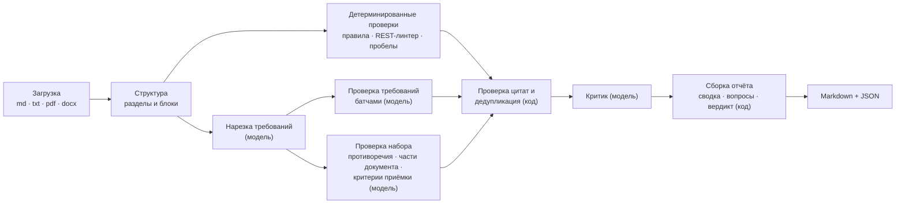

# Агент статической проверки требований

Агент читает документ требований (`.md`, `.txt`, `.pdf`, `.docx`), проверяет его по **ISO/IEC/IEEE 29148:2018** (п. 5.2.5, 5.2.6) и **IEEE 830-1998** (п. 4.3) и выпускает отчёт на русском: нарезку требований, нарушения с дословной цитатой и разделом, проверку набора целиком, вопросы автору ТЗ и вердикт «можно ли начинать разработку и тестирование».

## Для жюри

- **Отчёт по документу кейса:** [`reports/report.md`](reports/report.md) (+ [`reports/report.json`](reports/report.json)). Модель и версия агента указаны в паспорте отчёта.
- **Запуск одной командой** (Python 3.11+, ключ Google AI Studio: https://aistudio.google.com/apikey):

```bash
pip install -r requirements.txt
cp .env.example .env        # Windows: copy .env.example .env — и впишите GEMINI_API_KEY
python -m validator docs/requirements.md reports/report.md
```

- **Модель по умолчанию:** Google Gemini `gemini-3.5-flash` (бесплатный ключ), запасная `gemini-3.5-flash-lite`. Если ключу доступна `gemini-3.8-flash`, укажите её в `GEMINI_MODEL` — это лучший вариант. Поддерживается и Anthropic API (`LLM_PROVIDER=anthropic`).
- **Сколько стоит прогон:** 6–7 вызовов модели, ~150 тыс. входных и ~35 тыс. выходных токенов, 3–8 минут на бесплатном тарифе. Токены и оценка стоимости пишутся в паспорт каждого отчёта.
- **Если квота исчерпана или ключа нет:** агент сам переходит на запасную модель; без ключа работает `--rules-only` (только детерминированные проверки, вердикт «итог не определён»).
- **Уточнение «было → стало»:** ответьте на вопросы агента и перепроверьте ТЗ:

```bash
python -m validator --questions-template reports/report.json answers.yaml   # шаблон с вопросами
# впишите ответы в answers.yaml, затем:
python -m validator docs/requirements.md reports/after.md --previous reports/report.json --answers answers.yaml
```

  В новом отчёте появится раздел «Уточнение: было → стало»: какие дефекты закрыты ответами, что осталось, как изменился вердикт.
- **Веб-демо:** `python -m validator.web` → http://127.0.0.1:8000. Загрузка ТЗ с прогрессом этапов, просмотр готового отчёта без ключа, выгрузка `.md` и `.json`.

## Что проверяется и что в отчёте

| Уровень | Стандарт | Критерии |
| --- | --- | --- |
| Отдельное требование | ISO/IEC/IEEE 29148:2018, п. 5.2.5; IEEE 830, п. 4.3 | необходимость, уместность уровня, однозначность, полнота, единичность, выполнимость, проверяемость, корректность, соответствие |
| Набор требований | ISO/IEC/IEEE 29148:2018, п. 5.2.6; IEEE 830, п. 4.3 | полнота, согласованность, выполнимость, понятность, валидируемость |
| Спецификация | IEEE 830-1998, п. 4.3.5, 4.3.7, 4.3.8 | ранжирование, модифицируемость, трассируемость |

Разделы отчёта: **паспорт прогона** (документ, SHA-256, дата, модели, версия агента, вызовы, токены, стоимость) → **коротко** → **нарезка требований** (ID в отчёте — ID в документе — цитата) → **проверка каждого требования** → **проверка набора** (противоречия, согласованность частей документа, покрытие критериями приёмки, полнота) → **сводка** → **вопросы к автору ТЗ** (адресат, место, варианты ответа и их последствия) → **итог** («что исправить первым») → **приложение**. Каждое нарушение ссылается на дословную цитату и раздел.

## Архитектура



| Решает код | Решает модель |
| --- | --- |
| Чтение форматов (таблицы DOCX и PDF), разделы и блоки, ID требований в отчёте | Что считать требованием, его тип и формулировка |
| Правила: заглушки и пустые разделы, незаполненные шаблоны, ID и ранжирование, REST-линтер (метод и побочный эффект, коды статусов, типы запроса и ответа), разные единицы одной величины, идемпотентность без ключа, флаг при обязательных параметрах, однострочные схемы процессов | Смысловые дефекты каждого требования, противоречия между правилами, частями документа и критериями приёмки, пробелы в сценариях |
| Проверка каждой цитаты по тексту документа; находка без подтверждённой цитаты не попадает в отчёт | Объяснения, рекомендации, уточняющие вопросы |
| Нумерация, сводка, вердикт, Markdown и JSON | Решения критика проверяются кодом: удалить находку можно только с найденной в документе контрцитатой |

Надёжность и стоимость:
- **Бюджет вызовов:** профиль `standard` (по умолчанию) делает 6–7 вызовов, потолок 10; общий предел времени прогона; на Gemini вызовы идут последовательно, чтобы не упираться в лимит в минуту.
- **Ошибки API:** дневная квота, лимит в минуту, 503, таймаут и сеть различаются; дневная квота сразу переключает на запасную модель, сбой сети завершает прогон честным отчётом «только правила».
- **Кэш этапов** (`.cache/validator`): повторный запуск после обрыва не тратит квоту на готовые этапы.
- **Защита от инструкций внутри документа:** текст ТЗ экранируется и передаётся как данные; нормативные блоки нельзя отбросить; критик не может удалить находки правил.
- **Воспроизводимость без ключа:** `--save-trace DIR` сохраняет ответы модели, `--replay DIR` пересобирает тот же отчёт без сети и ключа.

## Как проверяли качество

`eval/` — офлайн-оценка без участия модели: эталонные списки дефектов, строгий подсчёт (дефект засчитан, только если совпало и место, и суть находки), нижняя граница точности и «шум» на заведомо корректных требованиях.

- **Корпус:** документ кейса и 17 синтетических банковских ТЗ из разных доменов с заложенными дефектами и корректными требованиями (`eval/docs`, `eval/gold`), из них 15 слепых: агент и промпты их не видели при разработке.
- **Только общие правила:** в промптах и правилах нет терминов из проверяемых документов, это проверяет тест `tests/test_prompt_leak.py`.
- **Каждое изменение принималось по замерам** (несколько прогонов на 9 документах; одна модель между прогонами даёт разброс 2–3 дефекта). Часть идей (отдельный генератор сценариев, разделение проверки набора, двойной проход, подсказки правил модели) не дала устойчивого прироста и в агент не вошла.

| Модель (профиль standard) | Документы | Найдено эталонных дефектов | Критичные | Вызовов на прогон |
| --- | --- | --- | --- | --- |
| Gemini `gemini-3.8-flash` | 9 документов × 2 прогона | 86–87% (строгий подсчёт), ~90% (оценка LLM-судьёй) | ~90–98% | 6.9 |
| Anthropic `claude-sonnet-5-5` | документ кейса | 21–25 из 27 | 5–7 из 7 | 6–7 |

Оценка отчёта: `python -m eval.score reports/report.json <эталон.json>`; абляции: `python -m eval.ablate <документ> --variants rules_only,no_critic,full`.

## Установка и параметры

```bash
pip install -r requirements.txt          # или: uv sync
pip install -r requirements-dev.txt      # тесты: python -m pytest -q
```

| Флаг | Назначение |
| --- | --- |
| `--json PATH` / `--no-json` | путь к JSON-отчёту (по умолчанию рядом с `.md`) / не писать JSON |
| `--profile economy\|standard\|deep` | бюджет вызовов (по умолчанию `standard`) |
| `--no-cache` | не использовать кэш этапов |
| `--rules-only` | только детерминированные проверки, без модели и ключа |
| `--questions-template REPORT.json OUT.yaml` | шаблон ответов на вопросы отчёта |
| `--previous REPORT.json --answers ANSWERS.yaml` | перепроверка с ответами автора, раздел «было → стало» |
| `--save-trace DIR` / `--replay DIR` | сохранить ответы модели / пересобрать отчёт из них без ключа |

| Переменная `.env` | По умолчанию | Назначение |
| --- | --- | --- |
| `LLM_PROVIDER` | `gemini` | `gemini` или `anthropic` |
| `GEMINI_API_KEY` / `ANTHROPIC_API_KEY` | — | ключ провайдера |
| `GEMINI_MODEL` | `gemini-3.5-flash` | основная модель Gemini |
| `GEMINI_FALLBACK_MODELS` | `gemini-3.5-flash-lite` | запасные модели через запятую |
| `ANTHROPIC_MODEL` | `claude-sonnet-5-5` | модель Anthropic |
| `PIPELINE_PROFILE` | `standard` | профиль вызовов |
| `RUN_DEADLINE_SECONDS` | 900 (Gemini) / 480 | общий предел времени прогона |
| `LLM_MODEL_EXTRACT`, `_CHECK`, `_SET`, `_REVIEW` | — | своя модель для отдельного этапа |

## Структура

```text
validator/      cli.py · config.py · loaders.py · structure.py · models.py · llm.py · answers.py
  rules/        правила, REST-линтер, проверки пробелов
  pipeline/     оркестратор, этапы, промпты, проверка цитат, постобработка, вердикт
  report/       сборка Markdown
  web/          веб-демо (FastAPI)
eval/           оценка: score, run, ablate, docs, gold
tests/          автотесты
reports/        отчёт по документу кейса
docs/           документ требований кейса
```

## Ограничения

- Изображения, диаграммы-картинки и PDF-сканы без текстового слоя не анализируются (в паспорт пишется предупреждение).
- Модель даёт разброс между прогонами; кэш и `--replay` делают конкретный отчёт воспроизводимым.
- Какая из двух противоречащих формулировок верна, решает автор ТЗ: агент формулирует вопрос и варианты ответа.
