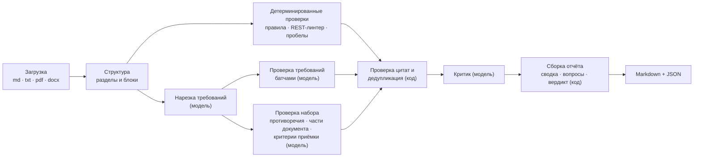

# Агент статической проверки требований

Агент читает документ требований (`.md`, `.txt`, `.pdf`, `.docx`), проверяет его по **ISO/IEC/IEEE 29148:2018** (п. 5.2.5, 5.2.6) и **IEEE 830-1998** (п. 4.3) и выпускает отчёт на русском языке.

Одной командой превращает ТЗ в отчёт: нарезка требований, нарушения с дословной цитатой и разделом, проверка набора целиком, вопросы автору ТЗ и вердикт «можно ли начинать разработку и тестирование».

## Быстрый старт

Нужны Python 3.11+ и ключ Google AI Studio: https://aistudio.google.com/apikey

```bash
pip install -r requirements.txt
cp .env.example .env        # Windows: copy .env.example .env — и впишите GEMINI_API_KEY
python -m validator docs/requirements.md reports/report.md
```

Модель по умолчанию — Google `gemini-3.5-flash` (бесплатный ключ). Прогон: 6–7 вызовов модели, 3–8 минут на бесплатном тарифе.

## Результаты на документе кейса

Отчёты сделаны агентом, без ручных правок. Модель, глубина рассуждения и версия агента записаны в паспорте каждого отчёта.

| Отчёт | Модель | Найдено эталонных дефектов* | Критичные | Вызовов / время, стоимость |
| --- | --- | --- | --- | --- |
| [`reports/report.md`](reports/report.md) — основной | Anthropic `claude-sonnet-5-5`, глубина рассуждения `high` (`LLM_EFFORT=high`) | 24 из 27 | 7 из 7 | 6 / ~6 мин, ~$1.0 |
| [`reports/gemini-3.8-flash/report.md`](reports/gemini-3.8-flash/report.md) | Google `gemini-3.8-flash` через OpenRouter (`LLM_PROVIDER=openrouter`), глубина рассуждения `high`, `LLM_MAX_OUTPUT_TOKENS=64000` | 24 из 27 | 7 из 7 | 8 / ~25 мин, ~$0.82 |

\* Оценка LLM-судьёй по нашему эталону из 27 дефектов: `gemini-3.8-flash` сравнивает находки с эталоном по смыслу.

## Проверка без ключа и сети

Оба отчёта пересобираются из сохранённых ответов модели — **без ключа и сети**:

```bash
python -m validator docs/requirements.md out.md --replay reports/trace                    # claude-sonnet-5-5
python -m validator docs/requirements.md out.md --replay reports/gemini-3.8-flash/trace   # gemini-3.8-flash
```

Без ключа работает и `--rules-only`: только детерминированные проверки, вердикт «итог не определён».

## Что проверяется

Пять категорий проверки, которые назвали организаторы, и где они в агенте:

| Категория | Критерии стандарта | Что ловит код без модели |
| --- | --- | --- |
| Дефекты формулировок | однозначность, единичность, соответствие | заглушки и пустые разделы, незаполненные шаблоны |
| Двусмысленность | однозначность, понятность набора | разные единицы одной величины, неопределённые границы периодов |
| Проверяемость | проверяемость, валидируемость | нефункциональные требования без измеримой величины или без точки отсчёта («в течение минуты» — до отправки или до доставки) |
| Логические противоречия | согласованность набора | противоречия между правилами, частями документа и критериями приёмки ищет модель, цитаты проверяет код |
| Лишние проектные решения | уместность уровня | бизнес-логика другой системы внутри спецификации API, REST-линтер; содержание уведомлений без правил маскирования карт и персональных данных (полнота) |

## Архитектура



- **Код:** чтение форматов, разделы и блоки, детерминированные правила, проверка каждой цитаты, нумерация, сводка, вердикт, Markdown и JSON.
- **Модель:** что считать требованием, смысловые дефекты, противоречия, объяснения и вопросы автору; критик.
- Находка без подтверждённой цитаты в документе не попадает в отчёт.

Подробнее — в [docs/DETAILS.md](docs/DETAILS.md): цикл уточнения «было → стало», веб-демо, оценка качества, флаги и переменные окружения, структура репозитория, ограничения.
